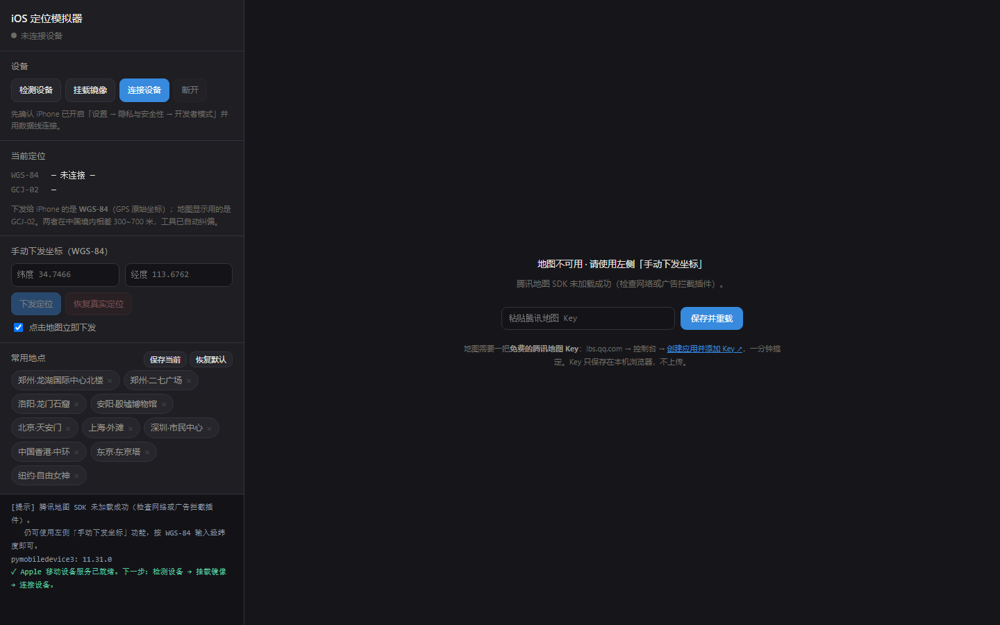
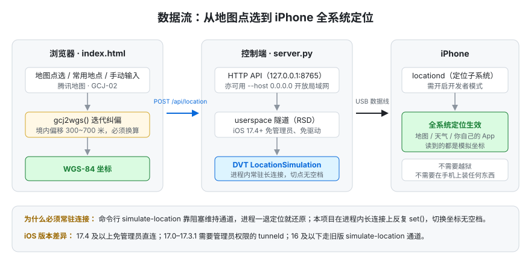

# iOS 定位模拟器（电脑侧控制端）

在地图上点一下，iPhone 的全系统定位就跳过去。用于**给自己的 App 做定位测试**：
地理围栏进出、定位上报、附近的人、跨城市业务逻辑等等。

不需要越狱，不需要在 iPhone 上装任何 App，Windows 上也不需要管理员权限。



> 截图为首次打开的状态：右侧填入自己的腾讯地图 Key 即可显示地图（1 分钟，见「地图与 Key」）；
> 不填也可以，左侧「手动下发坐标」按 WGS-84 输入，功能完全一致。

---

## 原理

苹果在 iOS 里给 Xcode 留了一条开发者调试通道（`DVT` → `LocationSimulation` 服务）。
`pymobiledevice3` 用开源方式复刻了这套协议，我们就能从电脑侧把模拟坐标喂给
iOS 的定位子系统（`locationd`），效果等同于 Xcode 里的 Simulate Location，但**全系统生效**。



**为什么必须常驻连接**：命令行版 `pymobiledevice3 developer dvt simulate-location set`
靠 `wait_return()` 阻塞来保持通道，进程一退出定位就还原。本项目在进程内维持一条
长连接，反复调用 `set()` 切换坐标，中间没有空档。

> 由于注入必须由外部设备通过调试通道发起，控制端只能跑在**电脑**上——
> iOS 不给 App 任何写 `locationd` 的 API，手机侧没有等价做法。

---

## 两个容易踩的坑（本项目已处理）

### 1. 坐标系偏移 300~700 米

国内所有合规地图（腾讯、高德、百度）用 **GCJ-02**（火星坐标，国家强制加密）；
而 iOS 的 `CLLocationManager` 和模拟定位走 **WGS-84**（GPS 原始坐标）。

直接把地图上点到的坐标发给手机，在中国境内会偏 300~700 米——测地理围栏必翻车。
`index.html` 里的 `gcj2wgs()` 用迭代逼近做了纠偏（收敛到亚米级）。界面同时显示两套坐标。

> 境外坐标不加密，转换函数会自动跳过。

### 2. iOS 版本决定要不要管理员权限

| iOS 版本 | Windows 上的要求 |
|---|---|
| **17.4 及以上** | 免驱动器、免管理员，直接可用 |
| 17.0 – 17.3.1 | 需要管理员权限的 `tunneld` + 额外驱动（官方不提供） |
| 16 及以下 | 走老的 `simulate-location` 通道，不需要隧道 |

---

## 快速开始

### 0. 前置条件

- **Python 3.12 独立环境**（`setup-env.bat` 一键建好，详见下方「Python 环境」）；
  其他 3.9+ 版本也能跑，但不如 3.12 省心
- iPhone 用**数据线**接电脑，手机上点「信任此电脑」
- iPhone 打开 **设置 → 隐私与安全性 → 开发者模式**（会重启一次）
  - 若找不到这个选项，先执行：`python -m pymobiledevice3 amfi reveal-developer-mode`
- **Windows 必须装官网版 iTunes**（<https://www.apple.com/itunes/download/win64>），
  不要用 Microsoft Store 的「Apple 设备」——后者会导致 USB/Wi-Fi 设备发现失效

### Python 环境

推荐给本项目单独建一个 **Python 3.12 环境**，依赖只装在里面，不污染全局 site-packages：

```bat
setup-env.bat                        :: 用 py 启动器里的 3.12
setup-env.bat "C:\Python312\python.exe"   :: 或者手动指定解释器
```

它会在 `envs\iosloc312\` 建好虚拟环境并装上依赖；之后双击 `start.bat` 会自动优先使用它
（`envs\` 已加入 `.gitignore`，不会进仓库）。

`start.bat` 的挑选顺序：

| 顺序 | 解释器 | 说明 |
|---|---|---|
| 1 | `%IOSLOC_PYTHON%` | 环境变量显式指定，优先于一切 |
| 2 | `envs\iosloc312\Scripts\python.exe` | `setup-env.bat` 建的项目内环境 |
| 3 | `py -3` | Windows 启动器里的最新 3.x |
| 4 | `python` | PATH 上的那个 |

硬性下限只有一条：**Python ≥ 3.9**（`pymobiledevice3` 自己的 `requires_python`）。
3.10 ~ 3.14 实测都能正常安装运行，选 3.12 是因为本项目就在这个版本上开发验证。

> 历史坑，供参考：`pymobiledevice3` 的传递依赖 `lzfse`（解压苹果镜像用）一度只发布到
> cp312 的预编译包，Python 3.13+ 会让 pip 退化成源码编译，报
> `Microsoft Visual C++ 14.0 or greater is required` → `Failed building wheel for lzfse`。
> 该问题已由 **`lzfse 0.4.2.post1`（2026-10-16 发布）** 解决，现在 cp39–cp315 都有
> `win_amd64` wheel，不再需要 MSVC。所以 3.13 / 3.14 用系统 Python 也能装，只是依赖会进全局。

### 1. 安装依赖

推荐先跑 `setup-env.bat`（见上），依赖会装在项目内的 3.12 环境里。
不想建环境、直接用系统 Python 也可以：

```bash
python -m pip install -U pymobiledevice3
```

### 2. 启动控制端

Windows 双击 `start.bat`（按上表顺序挑解释器，并校验 ≥ 3.9），或手动：

```bash
envs\iosloc312\Scripts\python.exe server.py   # 用了 setup-env.bat 就这样起
python server.py                              # 没用就交给系统 Python
python server.py --port 9000
```

控制端只监听本机回环地址（`127.0.0.1`），同一局域网内的其他设备访问不到。

### 目录结构

```
ios-location-sim/
├── server.py            # 控制端：HTTP API + 常驻 DVT 连接 + 隧道管理
├── index.html           # 前端界面：地图点选、坐标系纠偏、常用地点、日志
├── start.bat            # Windows 一键启动（自动挑选解释器）
├── setup-env.bat        # 建项目内的 Python 3.12 环境 envs\iosloc312（可选）
├── requirements.txt     # 依赖（注释里附「Python 环境」说明）
├── lookup_place.py      # 地名 → WGS-84 坐标查询（OpenStreetMap / Photon）
├── verify_coords.js     # 坐标系换算正确性验证
├── audit_presets.py     # 预置点反向地理编码审计
├── test_save_flow.js    # 「保存当前」取点逻辑回归测试
├── test_presets.js      # 常用地点增删逻辑回归测试
├── test_api_base.js     # 前端 API 地址解析测试（端口变更 / 同源失败回退）
└── docs/                # README 配图
```

### 3. 操作顺序

1. 点「**检测设备**」→ 确认能看到你的 iPhone（看不到就是驱动/信任问题）
2. 点「**挂载镜像**」→ 首次会从 Apple 服务器下载开发者磁盘镜像，比较慢，等日志跑完
3. 点「**连接设备**」→ 建立隧道 + DVT 通道
4. **在地图上点一下** → 定位立刻下发（勾选框控制是否自动下发）
5. 点「**恢复真实定位**」还原

> 状态栏（左上角圆点）会一直显示「已连接 xxxxxx」。**只要控制端窗口不关，模拟定位就一直有效**；
> 隧道建立在 USB 上，中途不能拔线。

---

## 查任意地点的 WGS-84 坐标

```bash
python lookup_place.py "龙湖国际中心北楼"
python lookup_place.py "二七广场" --limit 5
```

数据源是 OpenStreetMap，**返回的就是 WGS-84**，脚本同时算出 GCJ-02 供你在国内地图上
肉眼核对。它还会打印两点偏移量（境内约 500~600 米）和建筑范围。

界面左侧「常用地点」里的预置点也是用同一套方法取的实测坐标，可以直接点。

---

**常用地点怎么管**

| 操作 | 位置 |
|---|---|
| 下发到某个地点 | 点地点名 |
| 保存当前位置 | 「保存当前」（先在地图上点一下） |
| **删除某个地点** | 每个标签右侧的 **×**（会二次确认） |
| 找回内置地点 | 「恢复默认」 |

删除逻辑分两种，行为不一样：

- **自建地点**（你自己保存的）→ 从 localStorage 真正删除，删了就没了
- **内置地点** → 只是隐藏（记在 `iosloc.hidden`），点「恢复默认」可找回

「恢复默认」会同时清掉自建地点，用之前心里有数。

### 「保存当前」到底保存的是哪个点

规则（按优先级），**不依赖任何历史残留状态**：

1. 左下角「手动下发坐标」输入框里的经纬度（合法且在范围内）—— 就是你此刻看到的那个点
   - 在地图上点选、点常用地点，都会把坐标写进这两个框，所以这三条路径一致
2. 控制端上报的正在模拟的点（输入框为空时）
3. 都没有 → 明确报错，不会悄悄存一个别的地方

保存成功后，日志里会打印保存下来的确切坐标，方便核对。

> **修复记录**：早期版本「保存当前」读的是内部变量 `pickedWgs`，而它只在地图点击时更新，
> 手动输入下发或控制端回读的当前点都不更新它 —— 结果是**存下来的是"上次在地图上点过的地方"**，
> 表现为"保存后点这个标签，跳到别的地点去了"。已修复，并有回归测试（`test_save_flow.js`）。
> 在修复前保存的自定义地点坐标可能不准，删掉重新保存一次即可。

---

## 数据可靠性

预置点的坐标不是手填的，全部取自 OpenStreetMap 的具名地物，
并且用**反向地理编码**逐个核验过（即：拿这个坐标去问"这里是什么地方"，看回答对不对）。

```bash
python audit_presets.py     # 逐个反向核验预置点，打印最近具名地物与偏差
node test_presets.js        # 用 DOM 桩真跑一遍增删逻辑，18 项断言
```

最近一次审计结果：10 个点全部落在正确的具名地物上，偏差 0~6 米。

## 测试

除坐标审计外，所有测试**不依赖 iPhone、不依赖管理员权限**，clone 后即可运行
（测试会真实执行 `index.html` 里的前端代码，不是只做语法检查；需要 Node.js）：

| 命令 | 验证内容 |
|---|---|
| `node verify_coords.js` | GCJ-02 ↔ WGS-84 换算：境内偏移量在预期区间、境外零偏移、往返误差亚米级 |
| `node test_save_flow.js` | 「保存当前」的取点优先级：地图点选 / 手动输入 / 服务端回读三条路径一致 |
| `node test_presets.js` | 常用地点的保存 / 删除 / 隐藏 / 恢复默认逻辑 |
| `node test_api_base.js` | 前端 API 地址解析：默认端口、换端口、同源失败自动回退、本地文件打开 |
| `python audit_presets.py` | 预置坐标反向地理编码核验（需要外网，走 Photon） |

> 注意：`lookup_place.py` 依赖外网。国内网络环境下 Overpass API、OSM 官方 API、
> Nominatim、Wikidata 经常不可达，脚本默认走 **Photon（photon.komoot.io）**；
> 连不上时脚本会明确报错，而不是抛堆栈。

---

## 地图与 Key

地图用**腾讯地图**（国内合规要求；其数据是 GCJ-02，工具内部已自动纠偏成 WGS-84 再下发）。
默认需要你自己的免费 Key，填一次即可：

| 方式 | 说明 |
|---|---|
| **自己的 Key**（默认） | 见下方「申请免费 Key」，保存在本机浏览器 localStorage |
| 可选的凭据代理 | 内网若有地图代理，在页面加载前注入 `window._TMapSecurityConfig = { serviceHost: 'https://...' }` 即可免 Key |
| 不想申请 Key | 无地图；左侧「手动下发坐标」按 WGS-84 输入，功能完全一致 |

### 申请免费 Key（1 分钟）

1. 打开 <https://lbs.qq.com>，微信扫码登录
2. 控制台 → **创建应用**（名字随意）→ **添加 Key**（类型默认即可）
3. 复制 Key，在工具的地图区域粘贴 → 保存并重载

Key 只保存在本机浏览器的 localStorage 里，不上传到任何地方。
也可以直接带参数打开：`http://127.0.0.1:8765/?key=你的KEY`。

Key 无效（灰底空地图）时，地图区域会给出「清除」按钮，点掉重填即可。

---

## 接口

| 方法 | 路径 | 说明 |
|---|---|---|
| GET | `/api/status` | 连接状态、当前模拟坐标 |
| GET | `/api/log?since=N` | 增量拉取日志（前端轮询用） |
| POST | `/api/scan` | 列出电脑上发现的 iOS 设备 |
| POST | `/api/prepare` | 挂载开发者磁盘镜像 |
| POST | `/api/connect` | 建立隧道与 DVT 连接（异步，进度看日志） |
| POST | `/api/disconnect` | 断开 |
| POST | `/api/location` | `{"lat": 34.7466, "lon": 113.6762}`（**WGS-84**） |
| POST | `/api/clear` | 停止模拟，恢复真实 GPS |

---

## 排错

| 现象 | 原因 / 处理 |
|---|---|
| 检测不到设备 | 换一根**能传数据**的线；重装官网版 iTunes；手机上重新点「信任」 |
| `UserspaceTunnelUnavailableError` | 系统低于 iOS 17.4。用管理员身份运行 `python -m pymobiledevice3 remote tunneld` 并保持窗口开着 |
| `InvalidServiceError` / 找不到 DVT | 开发者磁盘镜像没挂上，先点「挂载镜像」，或确认开发者模式已开启 |
| 定位下发成功但 App 没反应 | 检查 App 的定位权限；确认 App 不是缓存的旧坐标；注意部分 App（尤其游戏反作弊）能识别模拟定位 |
| 地图空白 | 腾讯地图 SDK 没加载成功。本工具仍可用左侧「手动下发坐标」按 WGS-84 输入 |
| 定位过一会儿自己还原 | 控制端被关掉了。保持 `server.py` 运行 |

---

## 边界与红线

- 用于**测试自己的 App** 完全合规。苹果官方文档（Xcode → Simulating location）本身就是为此设计的。
- 别用于**考勤打卡作弊**。国内已有以「破坏计算机信息系统罪」或诈骗立案的判例。
- 游戏作弊会封号，自己权衡。
- iOS 18 之后系统加强了多源交叉校验（加速度计/陀螺仪、Wi-Fi BSSID 比对），
  移动轨迹不自然时可能被判定异常。别指望 100% 通过。
- 批量采集或存储他人位置数据需符合《个人信息保护法》，本工具只做本地单机测试，不联网上报。
